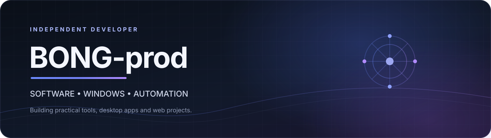

  

  
<strong>Independent developer · Desktop software · Windows · Automation</strong>

  
  
  

---

## 👋 Привет, я BONG-prod

Разрабатываю desktop- и web-приложения, инструменты для Windows и автоматизацию повседневных задач. Мне нравится превращать сложные процессы в понятные инструменты с аккуратным интерфейсом и предсказуемым поведением.

В разработке ценю не только функциональность, но и внимание к деталям: архитектуру, удобство использования, стабильность и визуальную целостность.

## Направления

- **Windows & Desktop** — системные инструменты, мониторинг, обслуживание и приложения для Windows.
- **Automation** — скрипты и автоматизация повторяющихся задач.
- **Web Development** — веб-приложения, авторизация, личные кабинеты и панели управления.
- **Integrations** — Discord-боты и интеграции между сервисами.

## 🚀 Selected projects

### IcySell — Windows desktop app

Десктопное приложение с инструментами мониторинга системы, очистки, оптимизации, управления автозагрузкой, настройками и интеграциями.

`Electron` `React` `Node.js` `Python`

Репозиторий с исходным кодом приватный.

### Web Platform

Веб-платформа с авторизацией через Discord, Google и VK, пользовательскими профилями, блогом и страницами управления.

`Node.js` `Express` `MongoDB` `EJS` `Passport`

Репозиторий с исходным кодом приватный.

### Discord Support Bot

Бот для поддержки проекта и взаимодействия с сообществом.

`Discord` `JavaScript`

Репозиторий с исходным кодом приватный.

## 🧰 Tech stack

  
  
  
  
  
  
  
  

## 🎮 BONG RUNNER — browser game

  

Небольшой браузерный платформер с автопилотом: персонаж сам бежит, рассчитывает прыжки, собирает монеты и покоряет шесть авторских миров. Можно отключить автопилот и управлять прыжками самостоятельно.

`HTML` `CSS` `JavaScript` `Canvas` `GitHub Pages`

## 🐍 Contribution snake

<picture>
  <source media="(prefers-color-scheme: dark)" srcset="https://raw.githubusercontent.com/BONG-prod/BONG-prod/output/github-contribution-grid-snake-dark.svg" />
  <source media="(prefers-color-scheme: light)" srcset="https://raw.githubusercontent.com/BONG-prod/BONG-prod/output/github-contribution-grid-snake.svg" />
  
</picture>

Автоматически обновляется каждый день через GitHub Actions.

## 🎯 Сейчас в фокусе

- Развитие инструментов и приложений для Windows.
- Автоматизация рутинных задач.
- Удобные интерфейсы и продуманный пользовательский опыт.
- Надёжность, поддерживаемость и качество реализации.

---

  Built with curiosity and attention to detail.
   
  Thanks for stopping by ✦

